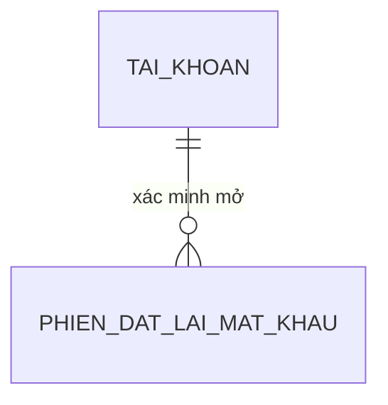
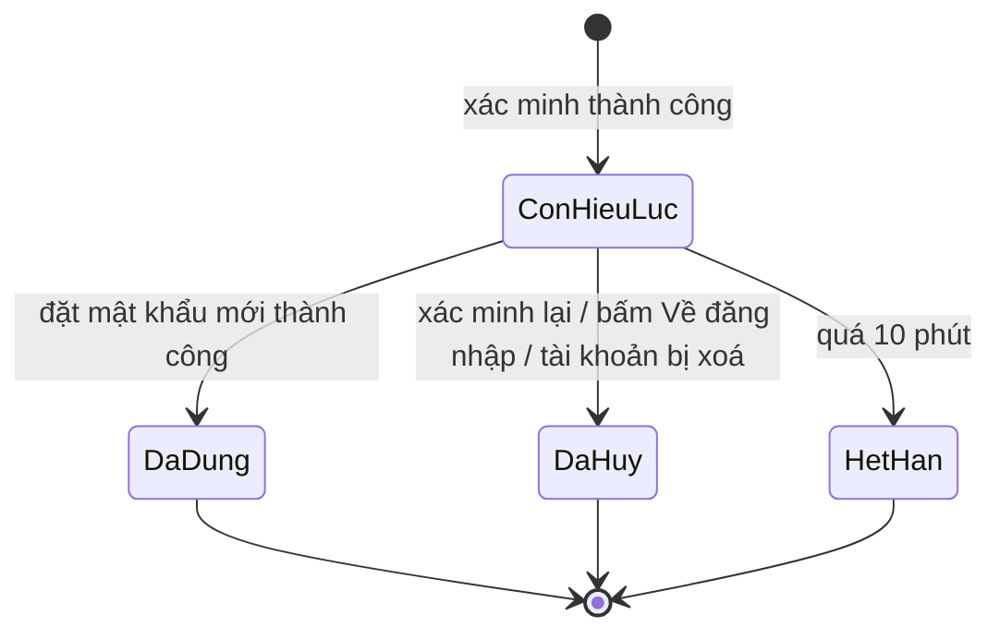

# FSD — Xác thực (AUTH)

| Phiên bản | Trạng thái | Cập nhật lần cuối | PRD |
|---|---|---|---|
| 1.0 | — | 2026-11-19 | [PRD-xac-thuc.md](PRD-xac-thuc.md) |

## Change Log

| Phiên bản | Ngày | Mô tả thay đổi | Tác giả |
|---|---|---|---|
| 1.0 | 2026-11-19 | Khởi tạo: AUTH-F01 Đăng nhập (chuyển từ login.md), AUTH-F02 Quên mật khẩu; chốt câu chữ, lỗi hệ thống (E2), mật khẩu 8–16 ký tự (A5), ô chỉ khoảng trắng = trống, A4 kiểm trước lỗi nhập, bỏ đặt lại (A6), phiên đặt lại 10 phút, email mẫu | BA Team |

---

## 1. AUTH-F01 — Đăng nhập

### Màn hình

#### AUTH-F01-SCR01

**Trang đăng nhập** — nhập tên đăng nhập và mật khẩu để vào hệ thống. Người dùng nội bộ dùng; mở khi vào hệ thống
chưa đăng nhập, khi phiên hết hạn, sau khi đăng xuất hoặc đặt lại mật khẩu.

```
+----------------------------------------------------------+
| 1 Đăng nhập                                              |
|                                                          |
| 2 <thông báo đặt lại mật khẩu thành công>                |
|                                                          |
| Tên đăng nhập                                            |
| [3                                                     ] |
| Mật khẩu                                                 |
| [4 ********                                            ] |
| 5 <thông báo lỗi>                                        |
|                                                          |
| [6 Đăng nhập]                                            |
|                                                          |
| 7 Quên mật khẩu?                                         |
+----------------------------------------------------------+
```

**Thành phần**

| # | Thành phần | Mô tả | Luồng |
|---|---|---|---|
| 1 | Tiêu đề | "Đăng nhập" | — |
| 2 | Thông báo thành công | "Đặt lại mật khẩu thành công. Đăng nhập bằng mật khẩu mới." | [AUTH-F02-US02](#auth-f02-us02) |
| 3 | Ô Tên đăng nhập | Nhập tên đăng nhập | [AUTH-F01-US01](#auth-f01-us01) |
| 4 | Ô Mật khẩu | Nhập mật khẩu, che ký tự | [AUTH-F01-US01](#auth-f01-us01) |
| 5 | Thông báo lỗi | Hiện khi nhánh A1, A2, E1, E2 | [AUTH-F01-US01](#auth-f01-us01)-A1, [AUTH-F01-US01](#auth-f01-us01)-A2, [AUTH-F01-US01](#auth-f01-us01)-E1, [AUTH-F01-US01](#auth-f01-us01)-E2 |
| 6 | Nút Đăng nhập | Gửi tên đăng nhập + mật khẩu | [AUTH-F01-US01](#auth-f01-us01) |
| 7 | Link "Quên mật khẩu?" | Mở [AUTH-F02-SCR01](#auth-f02-scr01) | [AUTH-F02-US01](#auth-f02-us01) |

**Quy tắc hiển thị**

| Điều kiện | Hiển thị |
|---|---|
| Vừa đặt lại mật khẩu thành công (AUTH-F02-US02) | Hiện 2; ẩn 2 khi tải lại trang hoặc khi bấm nút 6; các trường hợp khác ẩn 2 |
| Có phiên đăng nhập còn hiệu lực (AUTH-BR03, AUTH-BR07) khi mở trang này | Chuyển về [AUTH-F01-SCR02](#auth-f01-scr02) |
| Đang chờ hệ thống phản hồi | Nút 6 đổi thành "Đang đăng nhập…" và không bấm được |
| Không có lỗi | Ẩn 5 |

#### AUTH-F01-SCR02

**Trang chủ** — trang đầu tiên sau khi đăng nhập. Người dùng nội bộ đã đăng nhập dùng; mở sau khi đăng nhập thành
công.

```
+----------------------------------------------------------+
| 1 Xin chào <tên hiển thị>                  [2 Đăng xuất] |
| -------------------------------------------------------- |
|                                                          |
| 3 <nội dung trang chủ>                                   |
|                                                          |
+----------------------------------------------------------+
```

**Thành phần**

| # | Thành phần | Mô tả | Luồng |
|---|---|---|---|
| 1 | Lời chào | "Xin chào <tên hiển thị>" | [AUTH-F01-US02](#auth-f01-us02) |
| 2 | Nút Đăng xuất | Kết thúc phiên đăng nhập | [AUTH-F01-US03](#auth-f01-us03) |
| 3 | Nội dung trang chủ | Ngoài phạm vi module này | — |

### Luồng nghiệp vụ

#### AUTH-F01-US01

**Đăng nhập**

> Là người dùng nội bộ, tôi muốn đăng nhập bằng tên đăng nhập và mật khẩu, để vào trang chủ và dùng các chức năng
> của hệ thống.

- **Actor:** người dùng nội bộ
- **Tiền điều kiện:** người dùng có tài khoản; chưa đăng nhập
- **Kích hoạt từ:** [AUTH-F01-SCR01](#auth-f01-scr01) (6)

**Luồng chính**
1. Người dùng nhập tên đăng nhập và mật khẩu.
2. Người dùng bấm Đăng nhập.
3. Hệ thống kiểm tên đăng nhập (AUTH-BR01) và mật khẩu.
4. Hệ thống mở phiên đăng nhập (AUTH-BR03).
5. Hệ thống chuyển tới [AUTH-F01-SCR02](#auth-f01-scr02), hiện "Xin chào <tên hiển thị>".

**Luồng rẽ nhánh**
- **A1 — Bỏ trống** (tại bước 3): tên đăng nhập trống hoặc chỉ gồm khoảng trắng, hoặc mật khẩu trống → hiện "Nhập tên đăng nhập và mật khẩu" ở 5;
  quay lại bước 1.
- **A2 — Sai thông tin** (tại bước 3): tên đăng nhập không tồn tại hoặc sai mật khẩu → hiện "Sai tên đăng nhập hoặc
  mật khẩu" ở 5, không nói rõ sai cái nào (AUTH-BR02); quay lại bước 1.

**Ngoại lệ**
- **E1 — Không kết nối được máy chủ** (tại bước 3): hiện "Không kết nối được máy chủ" ở 5; không mở phiên.
- **E2 — Lỗi hệ thống** (tại bước 3): máy chủ gặp lỗi → hiện "Lỗi hệ thống" ở 5; không mở phiên.

**Hậu điều kiện**
- Thành công: người dùng có phiên đăng nhập còn hạn 1 giờ.
- Thất bại: không có phiên nào được mở.

#### AUTH-F01-US02

**Vào trang cần đăng nhập**

> Là người dùng nội bộ, tôi muốn hệ thống chỉ cho vào trang cần đăng nhập khi phiên còn hiệu lực, để người khác
> không dùng được tài khoản của tôi.

- **Actor:** người dùng nội bộ
- **Tiền điều kiện:** —
- **Kích hoạt từ:** mở [AUTH-F01-SCR02](#auth-f01-scr02) (hoặc trang khác cần đăng nhập); thao tác bất kỳ trên trang
  cần đăng nhập

**Luồng chính**
1. Người dùng mở trang chủ.
2. Hệ thống kiểm phiên đăng nhập còn hiệu lực (AUTH-BR03, AUTH-BR07).
3. Hệ thống hiện trang chủ với "Xin chào <tên hiển thị>".

**Luồng rẽ nhánh**
- **A1 — Chưa đăng nhập** (tại bước 2): chuyển về [AUTH-F01-SCR01](#auth-f01-scr01).
- **A2 — Phiên hết hiệu lực** (tại bước 2): phiên quá 1 giờ, hoặc mật khẩu đã được đặt lại sau khi mở phiên
  (AUTH-BR07) → lần thao tác kế tiếp chuyển về [AUTH-F01-SCR01](#auth-f01-scr01).

**Hậu điều kiện**
- Thành công: người dùng thấy trang chủ.
- Thất bại: người dùng ở trang đăng nhập, không còn phiên.

#### AUTH-F01-US03

**Đăng xuất**

> Là người dùng nội bộ, tôi muốn đăng xuất, để người khác dùng chung máy không vào được tài khoản của tôi.

- **Actor:** người dùng nội bộ
- **Tiền điều kiện:** đang đăng nhập
- **Kích hoạt từ:** [AUTH-F01-SCR02](#auth-f01-scr02) (2)

**Luồng chính**
1. Người dùng bấm Đăng xuất.
2. Hệ thống kết thúc phiên đăng nhập trên trình duyệt này.
3. Hệ thống chuyển về [AUTH-F01-SCR01](#auth-f01-scr01).

**Hậu điều kiện**
- Thành công: vào lại trang chủ phải đăng nhập lại ([AUTH-F01-US02](#auth-f01-us02)-A1).

## 2. AUTH-F02 — Quên mật khẩu

### Màn hình

#### AUTH-F02-SCR01

**Quên mật khẩu — xác minh tài khoản** — bước 1: nhập tên đăng nhập và email để chứng minh là chủ tài khoản. Người
dùng chưa đăng nhập dùng; mở từ link "Quên mật khẩu?" ở [AUTH-F01-SCR01](#auth-f01-scr01) (7).

```
+----------------------------------------------------------+
| 1 Quên mật khẩu                                          |
|                                                          |
| 2 Nhập tên đăng nhập và email của tài khoản để đặt lại   |
|   mật khẩu.                                              |
|                                                          |
| Tên đăng nhập                                            |
| [3                                                     ] |
| Email                                                    |
| [4                                                     ] |
| 5 <thông báo lỗi>                                        |
|                                                          |
| [6 Tiếp tục]                                             |
|                                                          |
| 7 < Về đăng nhập                                         |
+----------------------------------------------------------+
```

**Thành phần**

| # | Thành phần | Mô tả | Luồng |
|---|---|---|---|
| 1 | Tiêu đề | "Quên mật khẩu" | — |
| 2 | Hướng dẫn | "Nhập tên đăng nhập và email của tài khoản để đặt lại mật khẩu." | — |
| 3 | Ô Tên đăng nhập | Nhập tên đăng nhập | [AUTH-F02-US01](#auth-f02-us01) |
| 4 | Ô Email | Nhập email của tài khoản | [AUTH-F02-US01](#auth-f02-us01) |
| 5 | Thông báo lỗi | Hiện khi nhánh A1, A2, E1, E2 của US01; nhánh A4 của US02 | [AUTH-F02-US01](#auth-f02-us01)-A1, [AUTH-F02-US01](#auth-f02-us01)-A2, [AUTH-F02-US01](#auth-f02-us01)-E1, [AUTH-F02-US01](#auth-f02-us01)-E2, [AUTH-F02-US02](#auth-f02-us02)-A4 |
| 6 | Nút Tiếp tục | Gửi tên đăng nhập + email để xác minh | [AUTH-F02-US01](#auth-f02-us01) |
| 7 | Link "Về đăng nhập" | Mở [AUTH-F01-SCR01](#auth-f01-scr01) | — |

**Quy tắc hiển thị**

| Điều kiện | Hiển thị |
|---|---|
| Đang chờ hệ thống phản hồi | Nút 6 đổi thành "Đang kiểm tra…" và không bấm được |
| Có phiên đăng nhập còn hiệu lực (AUTH-BR03, AUTH-BR07) khi mở trang này | Chuyển về [AUTH-F01-SCR02](#auth-f01-scr02) |
| Không có lỗi | Ẩn 5 |

#### AUTH-F02-SCR02

**Quên mật khẩu — đặt mật khẩu mới** — bước 2: nhập mật khẩu mới cho tài khoản vừa xác minh. Người dùng chưa đăng
nhập dùng; mở sau khi xác minh thành công ở [AUTH-F02-SCR01](#auth-f02-scr01).

```
+----------------------------------------------------------+
| 1 Đặt mật khẩu mới                                       |
|                                                          |
| 2 Tài khoản: <tên đăng nhập>                             |
|                                                          |
| Mật khẩu mới                                             |
| [3 ********                                            ] |
|   Từ 8 đến 16 ký tự                                      |
| Nhập lại mật khẩu mới                                    |
| [4 ********                                            ] |
| 5 <thông báo lỗi>                                        |
|                                                          |
| [6 Đặt lại mật khẩu]                                     |
|                                                          |
| 7 < Về đăng nhập                                         |
+----------------------------------------------------------+
```

**Thành phần**

| # | Thành phần | Mô tả | Luồng |
|---|---|---|---|
| 1 | Tiêu đề | "Đặt mật khẩu mới" | — |
| 2 | Tài khoản | "Tài khoản: <tên đăng nhập>" — tài khoản vừa xác minh, chỉ đọc | — |
| 3 | Ô Mật khẩu mới | Nhập mật khẩu mới, che ký tự; gợi ý dưới ô: "Từ 8 đến 16 ký tự" (AUTH-BR04) | [AUTH-F02-US02](#auth-f02-us02) |
| 4 | Ô Nhập lại mật khẩu mới | Nhập lại, che ký tự | [AUTH-F02-US02](#auth-f02-us02) |
| 5 | Thông báo lỗi | Hiện khi nhánh A1–A3, A5, E1, E2 | [AUTH-F02-US02](#auth-f02-us02)-A1, [AUTH-F02-US02](#auth-f02-us02)-A2, [AUTH-F02-US02](#auth-f02-us02)-A3, [AUTH-F02-US02](#auth-f02-us02)-A5, [AUTH-F02-US02](#auth-f02-us02)-E1, [AUTH-F02-US02](#auth-f02-us02)-E2 |
| 6 | Nút Đặt lại mật khẩu | Lưu mật khẩu mới | [AUTH-F02-US02](#auth-f02-us02) |
| 7 | Link "Về đăng nhập" | Bỏ đặt lại, mở [AUTH-F01-SCR01](#auth-f01-scr01) | [AUTH-F02-US02](#auth-f02-us02)-A6 |

**Quy tắc hiển thị**

| Điều kiện | Hiển thị |
|---|---|
| **Khi mở trang**: chưa xác minh | Chuyển về [AUTH-F02-SCR01](#auth-f02-scr01), không hiện thông báo |
| **Khi mở trang**: phiên đặt lại đã hết hiệu lực (AUTH-BR06). (Hết hiệu lực **khi bấm nút 6**: xem [AUTH-F02-US02](#auth-f02-us02)-A4) | Chuyển về [AUTH-F02-SCR01](#auth-f02-scr01), hiện "Phiên xác minh đã hết hạn, vui lòng xác minh lại" ở 5 của màn đó |
| Có phiên đăng nhập còn hiệu lực (AUTH-BR03, AUTH-BR07) khi mở trang này | Chuyển về [AUTH-F01-SCR02](#auth-f01-scr02) |
| Đang chờ hệ thống phản hồi | Nút 6 đổi thành "Đang lưu…" và không bấm được |
| Không có lỗi | Ẩn 5 |

### Luồng nghiệp vụ

#### AUTH-F02-US01

**Xác minh tài khoản**

> Là người dùng nội bộ quên mật khẩu, tôi muốn xác minh mình là chủ tài khoản bằng tên đăng nhập và email, để được
> đặt mật khẩu mới.

- **Actor:** người dùng nội bộ (chưa đăng nhập)
- **Tiền điều kiện:** —
- **Kích hoạt từ:** [AUTH-F02-SCR01](#auth-f02-scr01) (6); vào màn này từ [AUTH-F01-SCR01](#auth-f01-scr01) (7)

**Luồng chính**
1. Người dùng nhập tên đăng nhập và email.
2. Người dùng bấm Tiếp tục.
3. Hệ thống kiểm tên đăng nhập và email thuộc cùng một tài khoản (AUTH-BR01, AUTH-BR05).
4. Hệ thống mở phiên đặt lại mật khẩu cho tài khoản đó (AUTH-BR06).
5. Hệ thống chuyển tới [AUTH-F02-SCR02](#auth-f02-scr02).

**Luồng rẽ nhánh**
- **A1 — Bỏ trống** (tại bước 3): tên đăng nhập hoặc email trống, hoặc chỉ gồm khoảng trắng → hiện "Nhập tên đăng nhập và email" ở 5; quay lại
  bước 1.
- **A2 — Không khớp** (tại bước 3): tên đăng nhập không tồn tại, email không đúng, hoặc tài khoản chưa có email →
  hiện "Tên đăng nhập hoặc email không đúng" ở 5, không nói rõ sai cái nào (AUTH-BR02); quay lại bước 1.

**Ngoại lệ**
- **E1 — Không kết nối được máy chủ** (tại bước 3): hiện "Không kết nối được máy chủ" ở 5; không mở phiên.
- **E2 — Lỗi hệ thống** (tại bước 3): máy chủ gặp lỗi → hiện "Lỗi hệ thống" ở 5; không mở phiên.

**Hậu điều kiện**
- Thành công: có một phiên đặt lại mật khẩu còn hạn cho tài khoản; mật khẩu chưa đổi.
- Thất bại: không có gì thay đổi.

#### AUTH-F02-US02

**Đặt mật khẩu mới**

> Là người dùng nội bộ đã xác minh, tôi muốn đặt mật khẩu mới, để đăng nhập lại được.

- **Actor:** người dùng nội bộ (chưa đăng nhập)
- **Tiền điều kiện:** đã xác minh ở [AUTH-F02-US01](#auth-f02-us01); phiên đặt lại còn hiệu lực (AUTH-BR06)
- **Kích hoạt từ:** [AUTH-F02-SCR02](#auth-f02-scr02) (6)

**Luồng chính**
1. Người dùng nhập mật khẩu mới.
2. Người dùng nhập lại mật khẩu mới.
3. Người dùng bấm Đặt lại mật khẩu.
4. Hệ thống kiểm mật khẩu mới (AUTH-BR04).
5. Hệ thống kiểm hai ô mật khẩu giống nhau.
6. Hệ thống lưu mật khẩu mới.
7. Hệ thống huỷ mọi phiên đăng nhập cũ của tài khoản (AUTH-BR07).
8. Hệ thống đóng phiên đặt lại mật khẩu (AUTH-BR06).
9. Hệ thống chuyển về [AUTH-F01-SCR01](#auth-f01-scr01), hiện "Đặt lại mật khẩu thành công. Đăng nhập bằng mật khẩu
   mới." ở 2.

**Luồng rẽ nhánh**
- **A1 — Bỏ trống** (tại bước 4): một trong hai ô trống → hiện "Nhập mật khẩu mới và nhập lại mật khẩu" ở 5; quay
  lại bước 1.
- **A2 — Mật khẩu quá ngắn** (tại bước 4): dưới 8 ký tự (AUTH-BR04) → hiện "Mật khẩu phải có ít nhất 8 ký tự" ở 5;
  quay lại bước 1.
- **A3 — Nhập lại không khớp** (tại bước 5): hiện "Mật khẩu nhập lại không khớp" ở 5; quay lại bước 1.
- **A4 — Phiên đặt lại hết hiệu lực** (tại bước 4, khi bấm nút 6; kiểm **trước** A1, A2, A3, A5): phiên quá hạn, đã dùng, đã bị huỷ, hoặc tài khoản không còn (AUTH-BR06) → chuyển về
  [AUTH-F02-SCR01](#auth-f02-scr01), hiện "Phiên xác minh đã hết hạn, vui lòng xác minh lại"; mật khẩu không đổi.
- **A5 — Mật khẩu quá dài** (tại bước 4): trên 16 ký tự (AUTH-BR04) → hiện "Mật khẩu tối đa 16 ký tự" ở 5; quay lại
  bước 1.
- **A6 — Bỏ đặt lại** (tại bước 1–3): người dùng bấm "Về đăng nhập" → hệ thống huỷ phiên đặt lại (AUTH-BR06),
  chuyển về [AUTH-F01-SCR01](#auth-f01-scr01); mật khẩu không đổi.

**Ngoại lệ**
- **E1 — Không kết nối được máy chủ** (tại bước 4): hiện "Không kết nối được máy chủ" ở 5; mật khẩu không đổi.
- **E2 — Lỗi hệ thống** (tại bước 4): máy chủ gặp lỗi → hiện "Lỗi hệ thống" ở 5; mật khẩu không đổi.

**Hậu điều kiện**
- Thành công: tài khoản có mật khẩu mới; mật khẩu cũ không đăng nhập được nữa; mọi phiên đăng nhập cũ hết hiệu lực
  ([AUTH-F01-US02](#auth-f01-us02)-A2); phiên đặt lại đã đóng.
- Thất bại: mật khẩu và các phiên giữ nguyên.

## 3. Mô hình dữ liệu



Cột hệ thống dùng chung: mã định danh (`id`), thời điểm tạo (`createdAt`).

### 3.1 Tài khoản (`users`)

*Tài khoản đăng nhập của người dùng nội bộ, tạo sẵn (hiện là dữ liệu mẫu; sau này do quản trị viên tạo).*

| Thuộc tính | Cột | Kiểu | Bắt buộc | Quy tắc | Ý nghĩa |
|---|---|---|---|---|---|
| Tên đăng nhập | `username` | Chuỗi | ✔ | Duy nhất, không phân biệt hoa thường (AUTH-BR01) | Dùng để đăng nhập và xác minh |
| Tên hiển thị | `name` | Chuỗi | ✔ | — | Hiện ở lời chào trang chủ |
| Email | `email` | Chuỗi | — | Duy nhất nếu có (theo `docs/SRS-quan-ly-nhan-vien.md` §5); so không phân biệt hoa thường (AUTH-BR05) | Dùng xác minh khi quên mật khẩu. **Mới** |
| Mật khẩu | `passwordHash` | Chuỗi (đã băm) | ✔ | Mật khẩu mới 8–16 ký tự (AUTH-BR04) | Chỉ lưu dạng băm |

**Ràng buộc**
- Dữ liệu mẫu: `admin` → `admin@project1.local`, `user1` → `user1@project1.local`.
- Không có email thì không đặt lại mật khẩu được (AUTH-BR05, [AUTH-F02-US01](#auth-f02-us01)-A2).
- Đặt lại mật khẩu làm mọi phiên đăng nhập cấp trước đó hết hiệu lực (AUTH-BR07).

### 3.2 Phiên đặt lại mật khẩu (`?`)

*Quyền đặt mật khẩu mới, mở ra khi xác minh thành công ở [AUTH-F02-US01](#auth-f02-us01).*

| Thuộc tính | Cột | Kiểu | Bắt buộc | Quy tắc | Ý nghĩa |
|---|---|---|---|---|---|
| Tài khoản | `?` | → Tài khoản | ✔ | — | Tài khoản được đặt lại mật khẩu |
| Hết hạn lúc | `?` | Ngày giờ | ✔ | Thời điểm xác minh + 10 phút (AUTH-BR06) | Quá thời điểm này thì không dùng được |
| Trạng thái | `?` | Enum `con_hieu_luc`\|`da_dung`\|`da_huy` | ✔ | Đổi theo vòng đời dưới đây (AUTH-BR06); "hết hạn" không lưu, suy ra từ Hết hạn lúc | Mỗi phiên chỉ dùng một lần |

**Vòng đời**



## 4. Để `/dev` chốt

- Cách huỷ phiên đăng nhập cũ khi đặt lại mật khẩu (AUTH-BR07) — phiên hiện là JWT không lưu phía máy chủ.
- Dạng lưu / truyền phiên đặt lại mật khẩu (AUTH-BR06) giữa hai màn hình, tên cột của §3.2.
- Đường dẫn trang của AUTH-F02-SCR01, AUTH-F02-SCR02.
- API test (`/api/test/users`) nhận thêm email để e2e tạo tài khoản có / không có email.
